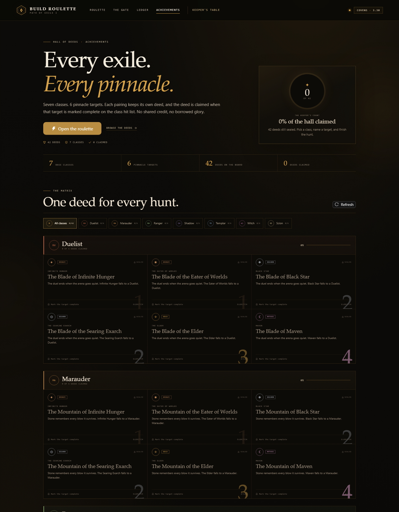
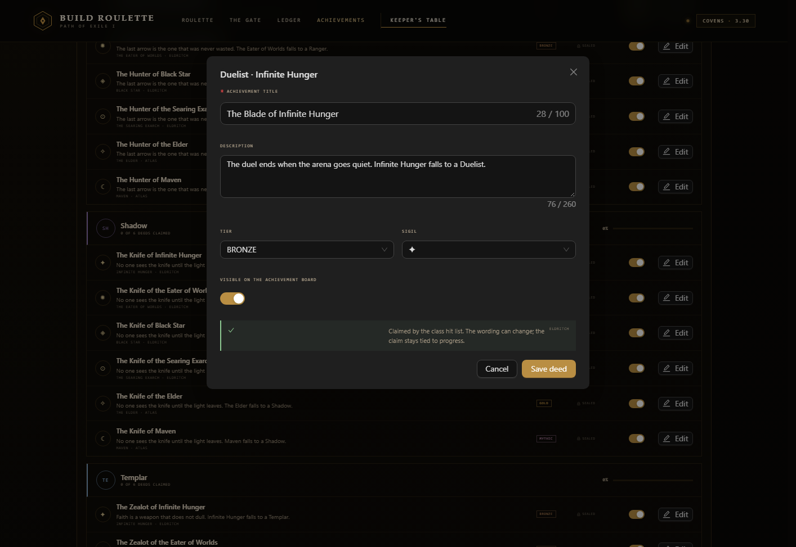

# PoE Build Roulette

A fan-made build roulette for **Path of Exile 1**, built around the **Covens of Umbra** ladder snapshot. Choose a class and a pinnacle target, then let the wheel pick the main skill and ascendancy. Every class keeps its own hit list and its own achievements.



> Fan project. Not affiliated with or endorsed by Grinding Gear Games or poe.ninja.
> Ladder data is a fixed snapshot; live builds move.

## Features

### Three roulette modes

| Mode | Class | Main skill | Ascendancy | PoE.ninja check |
| --- | --- | --- | --- | --- |
| **Classic** | Chosen on the start screen | From the class pool captured at 0.3% usage | Verified class path | Yes |
| **Chaos** | Chosen on the start screen | Any of the 198 known main skills | Any class ascendancy | No |
| **Streamers** | Drawn from the poe.ninja Streamers tab | Used by that class in the streamer snapshot | Used by those streamer builds | No |

- One reroll per rolled stage. In Streamers, the class is drawn and can be rerolled once.
- Classic uses the editable class pools and the PoE.ninja usage floor.
- Chaos removes both the class skill filter and the population gate.
- Streamers draws from **80 complete builds by 79 streamers** using **48 main skills** in Covens + SSF Covens, and links the final result to the exact streamer character page.

### Hit list and achievements

- Seven classes, six pinnacle targets, one editable leaflet.
- Marking a target complete on a class hit list claims that class's achievement.
- Unmarking it returns the deed to the sealed state.
- **42 achievements** currently: one for every class and target.
- Filter the hall by class, see per-class progress, claim dates, tiers, and sigils.



### Keeper's table (`/admin`)

- Add, edit, hide, delete, and restore pinnacle targets.
- Edit each class's Classic skill pool and visibility.
- Switch the Classic PoE.ninja gate on or off.
- Edit every achievement: title, description, tier, sigil, and visibility; restore all default wording.
- Adding a target seeds seven new achievements. Deleting a target removes them.

## Tech stack

- [Nuxt 3](https://nuxt.com/) SPA (`ssr: false`)
- Vue 3 `<script setup>`
- [Ant Design Vue](https://www.antdv.com/)
- Nitro API routes
- [Drizzle ORM](https://orm.drizzle.team/) + SQLite (libSQL)
- poe.ninja data captured as a static snapshot and bundled in `server/assets/`

## Requirements

- Node.js **20 or newer**
- npm **10 or newer** (pnpm works too)

## Quick start

```bash
git clone <your-repository-url> poe-build-roulette
cd poe-build-roulette

npm install

# macOS / Linux
cp .env.example .env

# Windows PowerShell
# Copy-Item .env.example .env
```

Open `.env` and set:

```dotenv
NUXT_SESSION_PASSWORD=<at least 32 random characters>
NOCCO_ADMIN_PASSWORD=<your admin password>
```

Then create the SQLite schema and start the dev server:

```bash
npm run db:push
npm run dev
```

Open <http://localhost:3000>. The first start seeds:

- the poe.ninja pairing snapshot,
- the seven editable class pools,
- the six-target leaflet,
- the 42 class/target achievements,
- the admin account (`admin` / `NOCCO_ADMIN_PASSWORD`).

The database file is `sqlite.db` in the project root. It is intentionally ignored by Git.

## Production build

```bash
npm run build
node --env-file=.env .output/server/index.mjs
```

Set `PORT` and `HOST` if the defaults do not fit your host:

```bash
PORT=3000 HOST=0.0.0.0 node --env-file=.env .output/server/index.mjs
```

`--env-file` requires Node.js 20.6+. If your host injects environment variables directly, omit the flag.

## Scripts

| Command | What it does |
| --- | --- |
| `npm run dev` | Start Nuxt in development on port 3000 |
| `npm run build` | Build the production client and Nitro server |
| `npm run preview` | Preview the built app |
| `npm run db:push` | Create or update the SQLite schema from `server/db/schema.ts` |

## Data and scope

- League label: **Covens of Umbra**, patch **3.30**.
- Class pools and Classic verification use **Covens + SSF Covens** data, with a **0.3%** class-usage floor.
- The Streamers mode uses a captured snapshot of the [poe.ninja Streamers tab](https://poe.ninja/poe1/builds/streamers), not a live scrape. The final build links to the captured character page.
- Achievements are derived from `goal_progress`; the admin edits presentation, not the unlock state.
- `sqlite.db` is not shipped. Run `npm run db:push` once, then let the seed plugins fill it.

## Project structure

```text
.
├─ assets/                  Global design tokens
├─ components/              Shared Vue components
├─ composables/             Auth and shell helpers
├─ docs/                    README screenshots
├─ layouts/                 Site shell
├─ middleware/              Global auth middleware
├─ pages/
│  ├─ index.vue             Roulette, modes, hit list, ledger
│  ├─ achievements.vue      Hall of deeds
│  ├─ admin.vue             Keeper's table
│  └─ login.vue
├─ plugins/                 Ant Design and dev-preview plugins
├─ server/
│  ├─ api/                  Nitro routes (public + admin)
│  ├─ assets/               Captured poe.ninja JSON snapshots
│  ├─ db/                   Drizzle schema and client
│  ├─ plugins/              Seed jobs
│  └─ utils/                Roulette, achievements, goals, classes
├─ app.vue
├─ nuxt.config.ts
├─ drizzle.config.ts
└─ package.json
```

## Resetting local data

To start over, stop the server, delete `sqlite.db`, and run `npm run db:push` again. This removes rolls, hit-list progress, admin edits, and achievement claims.

To change the admin password on an existing install, remove the database first (or update the `users` row yourself) and start with a new `NOCCO_ADMIN_PASSWORD`.

## Security

- `.env` is ignored by Git. Never commit real session or admin secrets.
- The admin routes require the admin role.
- The app has no public account registration; the first admin is seeded from `NOCCO_ADMIN_PASSWORD`.

## License

[MIT No Attribution](LICENSE).

Path of Exile is a trademark of Grinding Gear Games. poe.ninja data belongs to its respective owners.
